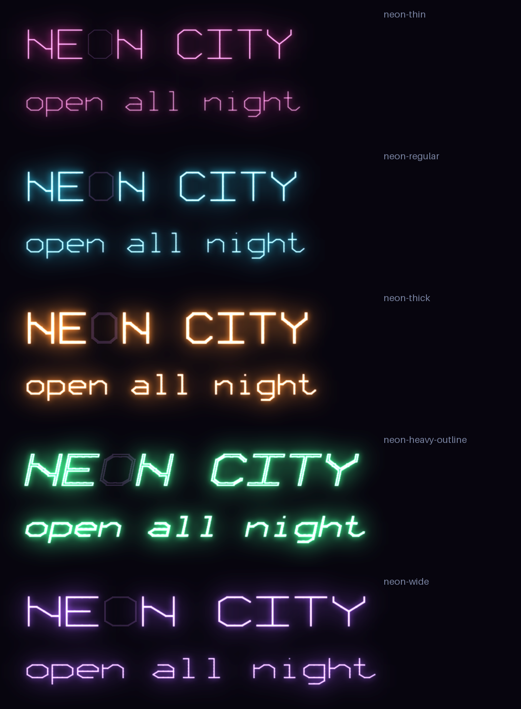
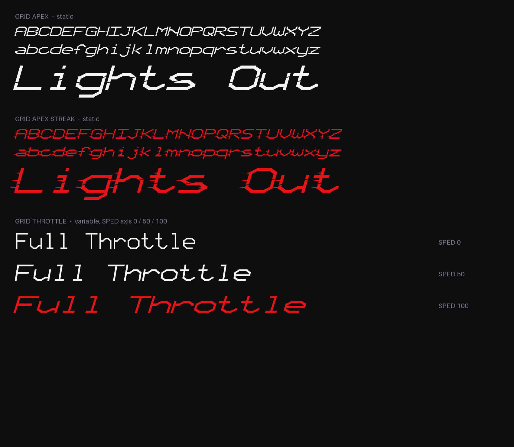
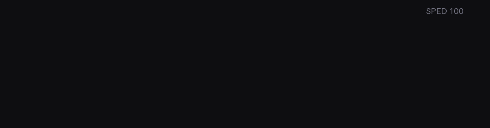
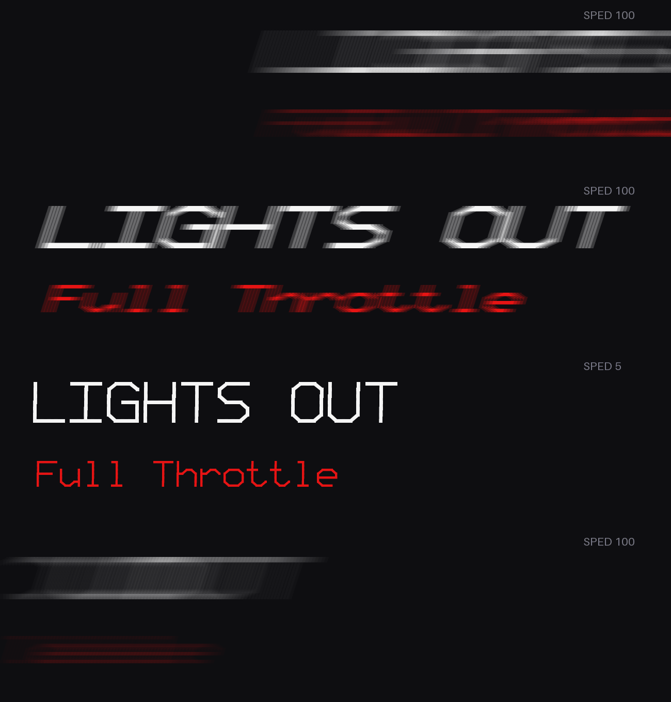
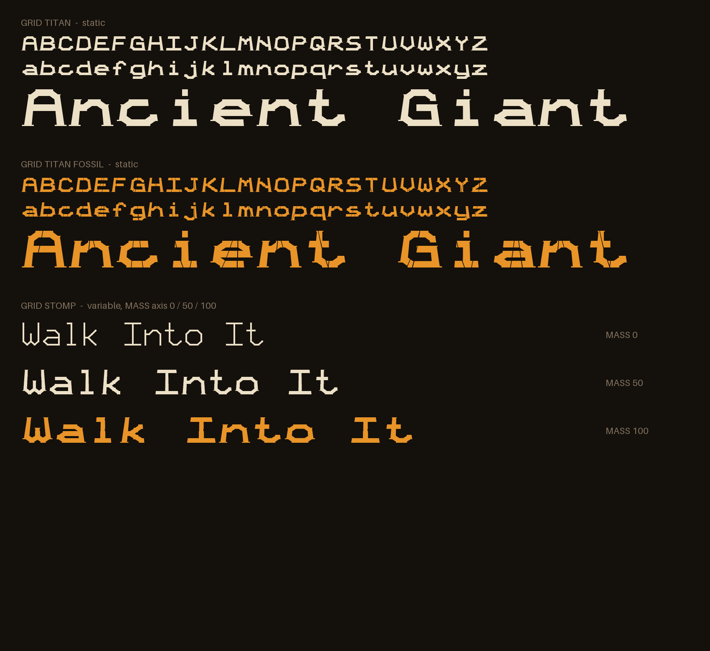
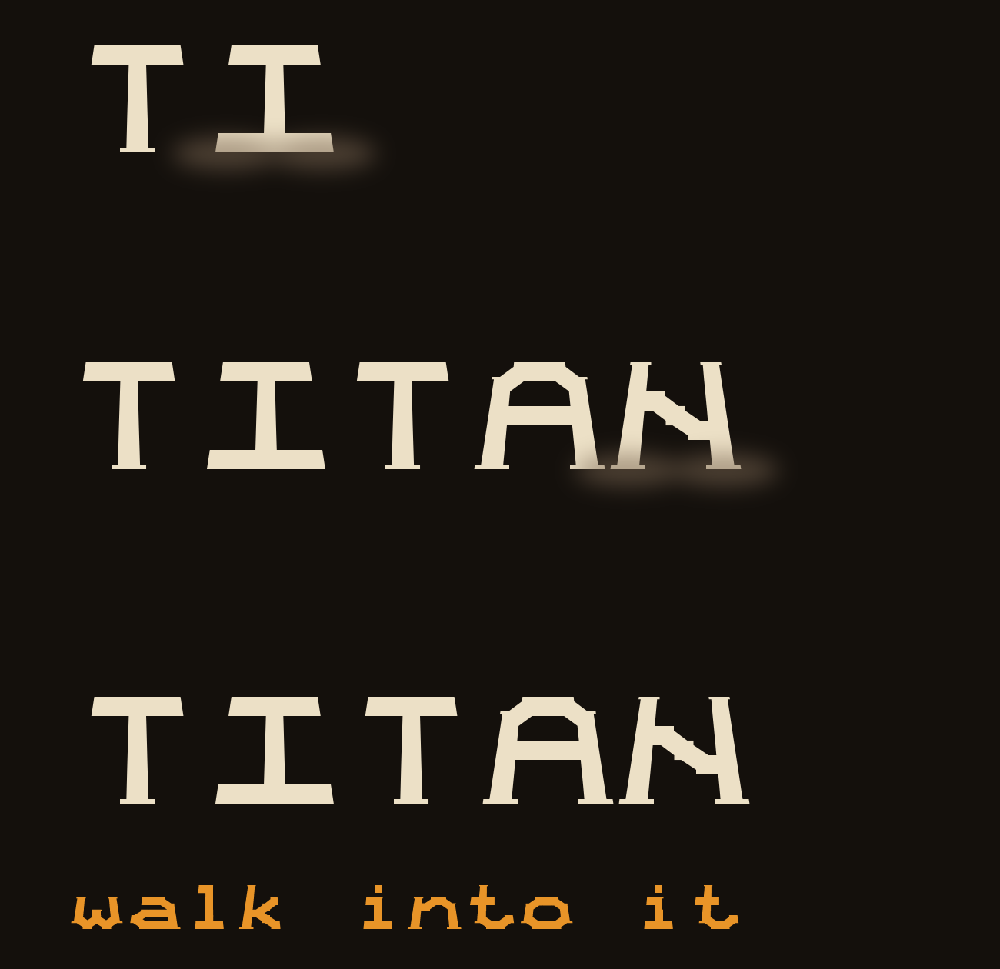
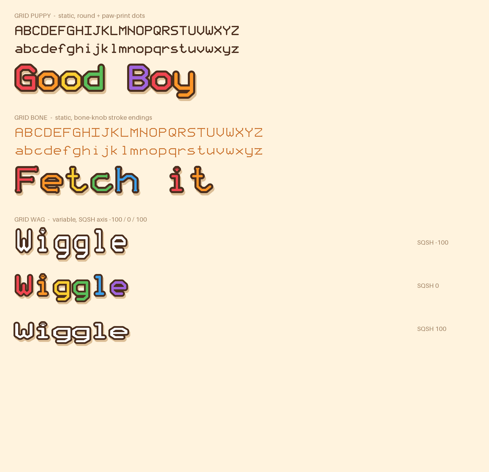
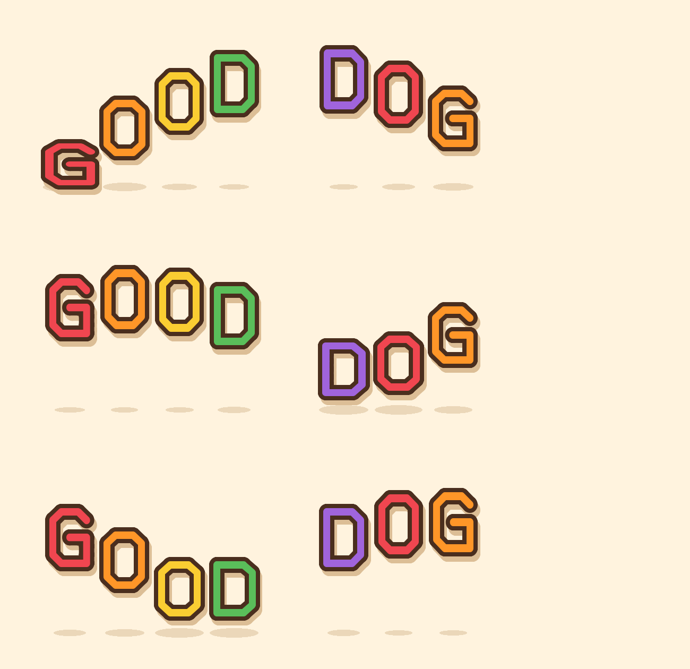

# GRID Fonts

An experiment in building game fonts with code: one 5×7 grid skeleton, many styles (sci-fi HUD, neon, F1 speed, monumental, cute dog-themed), exported as real `.ttf` files for Unreal Engine.



## How it works

1. **Skeleton** (`scripts/skeleton.py`): every letter A–Z / a–z is a few rows of `#` cells on a 5×7 grid (2 extra rows for descenders).
2. **Renderer**: each style decides how a cell becomes outlines.
   - v1 (`gridfont.py`): each cell becomes a square/chamfered dot (LED look).
   - v2 (`gridfont2.py`): neighbouring cells join into strokes, and lone diagonals become 45° cuts (futuristic look).
3. **Export**: fontTools builds the glyphs, metrics and character map into `.ttf`. Variable fonts are built from 2–3 masters with identical point structure.
4. **Neon** (`neon.py`): a preview renderer with a dead glass tube, wide bloom, tight halo, white-hot core and per-letter flicker.

## v3: Speed (F1-style racing fonts)



The goal was letters that feel fast before they even move. Four design moves do it, all applied to the same skeleton:

1. **Extended width:** columns are about 1.7× wider than rows, so letters stretch horizontally like they're being pulled.
2. **Heavy strokes:** thick stems give weight and power.
3. **Hard italic (16–18°):** everything leans forward, which reads as forward motion.
4. **The speed cut:** a thin, slightly rising slash cuts through every letter. It is done geometrically: each stroke polygon is clipped against two slanted lines (Sutherland–Hodgman), leaving a gap, and the overlaps are then merged into clean outlines with `removeOverlaps`.

**GRID Apex Streak** adds tapered **motion streaks** trailing off the left edge of each letter (rows 1, 3, 5), like the speed lines in racing graphics.

**GRID Throttle VF** has one custom axis, `SPED` (0–100). At 0 it is upright, narrow and light; at 100 it is wide, heavy and race-italic. Animating it reads like a car accelerating.



The animation preview shows the text flying in with horizontal motion blur, braking to `SPED 0` (upright), revving back to 100, and blasting out. Key frames:



**Ideas for Unreal:** drive the `SPED` look in-game by swapping exported instances (0/25/50/75/100) on boost; use Apex Streak for lap times and position banners; put a UMG animation with a quick X-translation and a blur material on title cards.

## v4: Titan (monumental, "dinosaur" weight)



The brief was letters that feel **stable, heavy, super strong**, like a giant you could walk into. Four design moves:

1. **Ultra-heavy strokes:** the stroke is about 19% of the cap height (Speed is about 12%), so counters shrink and the letters become solid mass.
2. **Slab feet:** every stem that ends at the bottom gets a wide, thick slab, and stem tops get a smaller cap. The letters look planted on the ground.
3. **Pyramid flare:** each glyph is scaled horizontally by height, about 30% wider at the baseline than at the top. Monuments, pyramids and a dinosaur's legs widen at the base, and that's what reads as *stable*.
4. **Fossil cracks:** in **GRID Titan Fossil**, every letter gets 1–2 near-vertical crack gaps at seeded random positions, so each letter cracks differently and consistently, like a stone tablet.

**GRID Stomp VF** has one custom axis, `MASS` (0–100). At 0 it's a light, plain monoline; at 100 it's full Titan (heavy, flared, slab-footed).


In the animation, letters drop one by one (gravity: accelerating fall), each landing triggers **screen shake and a dust puff**, then "walk into it" gains `MASS` from 0 to 100. Key frames:



**Ideas for Unreal:** boss names and chapter titles (Titan), ruins and ancient-temple signage (Fossil), and a camera shake plus dust Niagara burst timed to each letter landing for a title card.

## v5: Pup (dog-themed match-3)



A match-3 game about dogs needs the opposite of Titan: **soft, round, chewable, happy**. The design moves:

1. **Puffy round strokes:** every cell is a real curve-built circle (quadratic Béziers), joined by bars, so all ends and joints are rounded like plush toys or candy tiles. Overlaps are merged into clean outlines.
2. **Paw-print dots:** the dots on `i` and `j` are replaced with a paw (one pad and four toes). Small detail, instant theme.
3. **Bone endings (GRID Bone):** every stroke that ends gets two round knobs perpendicular to the stroke, like the end of a dog bone. The script finds endings automatically: cells with exactly one straight neighbour and no diagonal.
4. **Match-3 presentation:** tile colours per letter, a thick dark cartoon outline and a soft drop shadow. In Unreal this is UMG Outline and Shadow settings, so no extra font is needed.

**GRID Wag VF** has one custom axis, `SQSH` (-100 to 100). Negative values stretch (tall and narrow), positive values squash (short and wide), around the baseline. It's the classic animation principle of **squash and stretch**.


In the animation, letters hop in a wave like an excited puppy. Each letter **squashes on landing and stretches in the air**, and its ground shadow shrinks while it's airborne. Key frames:



**Ideas for Unreal:** combo text ("Good Boy!", "Pawsome!") bouncing in with Wag instances; Bone for score and buttons; paw-dot `i` in the title logo; a Niagara burst of paw prints on match.

## Fonts

| Folder | Font | Type |
|---|---|---|
| `fonts/v5-pup` | GRID Puppy | static, puffy round strokes, paw-print dots |
| | GRID Bone | static, bone-knob stroke endings |
| | GRID Wag VF | variable: `SQSH` (stretch to squash) |
| `fonts/v4-titan` | GRID Titan | static, ultra heavy, slab feet, pyramid flare |
| | GRID Titan Fossil | static, Titan with cracked-stone splits |
| | GRID Stomp VF | variable: `MASS` (light to monumental) |
| `fonts/v3-speed` | GRID Apex | static, heavy extended italic with speed cut |
| | GRID Apex Streak | static, Apex plus motion streaks |
| | GRID Throttle VF | variable: `SPED` (upright to race italic) |
| `fonts/v2-futuristic` | GRID Neon | static, hairline HUD |
| | GRID Velocity | static, heavy extended italic |
| | GRID Pulse VF | variable: `wght` (stroke thickness) |
| | GRID Morph VF | variable: `wdth` (extension), `slnt` (lean) |
| `fonts/v1-dots` | Block, Stencil, Pulse VF, Morph VF | first dot-matrix experiment |

## Rebuild

```bash
pip install fonttools pillow
python scripts/gridfont.py     # v1 -> out/
python scripts/gridfont2.py    # v2 -> out2/
python scripts/neon.py         # neon previews -> out2/neon/ (needs v2 built first)
pip install skia-pathops       # needed by v3 for overlap removal
python scripts/speedfont.py    # v3 speed fonts + previews -> out3/
python scripts/titanfont.py    # v4 titan fonts + previews -> out4/
python scripts/dogfont.py      # v5 pup fonts + previews -> out5/
```

## Unreal notes

- Drag a `.ttf` into the Content Browser to get a Font Face, then use it in UMG or a Text Render component.
- Variable-font axes aren't animated by Unreal's text renderer. Export instances, or animate with a material.
- Neon in-world: use a Text Render with an emissive material (colour × intensity × ~20), let bloom do the glow, and drive intensity from `Time` + noise for flicker.

## Not done yet

Digits, punctuation, kerning, accented characters, and a finer grid for M/N/W.

Made with AI assistance (Claude).
